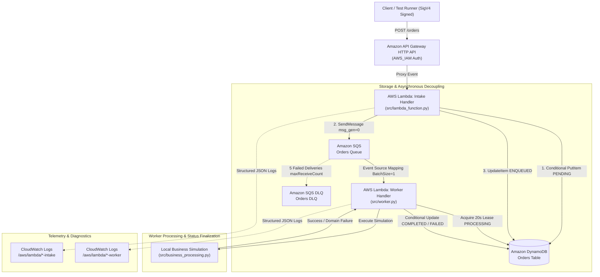

# AWS Serverless Order Processing System

An asynchronous, event-driven order processing backend built with AWS serverless services. This repository provides a reference implementation demonstrating event-driven decoupling, idempotent request ingestion, distributed worker lease management, transient failure retries, dead-letter queue (DLQ) mechanics, and least-privilege Infrastructure as Code (IaC).

> [!NOTE]
> **Educational & Architectural Baseline**: The order fulfillment workflow in this project uses a deterministic local simulation (`src/business_processing.py`). It validates business payloads and exercises lifecycle transitions without executing live financial transactions, debiting payment gateways, or allocating physical inventory.

---

## 1. Project Status

- **Status**: Development & Architecture Validation Baseline
- **Runtime Target**: Python 3.12 (AWS Lambda standard-library baseline)
- **Local Validation**: 160 unit and integration tests passing offline via `unittest`
- **Infrastructure Templates**: AWS SAM (`template.yaml`) and AWS CloudFormation (`template.console.yaml`) verified with `cfn-lint`
- **Deployment State**: The repository provides validated deployment templates and a packaging pipeline. Live cloud deployment and automated CI/CD pipelines (e.g., GitHub Actions) are not currently configured or asserted as live.

---

## 2. Key Features

- **Asynchronous Ingestion Decoupling**: Ingestion is decoupled from processing using Amazon API Gateway HTTP API and Amazon SQS, allowing the intake layer to return immediate responses while work executes in the background.
- **Idempotent Ingestion & Deduplication**: Orders are hashed (`SHA-256`) over canonical payload attributes. Duplicate submissions with identical payloads return the existing order safely, while differing payloads reusing an existing `order_id` are rejected with HTTP 409 Conflict.
- **Atomic Worker Lease Management**: Background workers acquire time-bounded exclusive leases via conditional DynamoDB updates, preventing concurrent execution races when duplicate deliveries occur.
- **Resilient Retry Handling & Dead-Letter Queue (DLQ)**: Ephemeral faults trigger unacknowledged SQS batch redeliveries. Persistently failing or malformed messages route to an SQS Dead-Letter Queue (`maxReceiveCount: 5`) for isolated investigation.
- **Precise Decimal Handling & Boundary Validation**: Request monetary fields and quantities are parsed and validated using exact `Decimal` precision, preventing floating-point approximation errors and enforcing DynamoDB numeric constraints before database persistence.
- **Least-Privilege Security Posture**: Separate, narrowly scoped IAM execution roles for intake and worker functions; perimeter payload size restrictions (64 KiB cap); zero wildcard (`*`) resource permissions; and API routes protected with AWS IAM (SigV4) authorization.
- **Standard Library First Architecture**: Core application runtime logic relies exclusively on Python standard libraries, reducing cold-start latency and eliminating external supply-chain dependencies.

---

## 3. System Architecture

The following diagram illustrates the event-driven request flow, storage boundaries, and observability components:



---

## 4. End-to-End Request Lifecycle

1. **Client Submission**: The client sends an HTTP `POST /orders` request to API Gateway signed with AWS SigV4 credentials.
2. **Perimeter Checks & Validation**: The Intake Lambda checks payload byte size (enforcing the 64 KiB cap) and validates required fields (`order_id`, `customer_id`, `items`, `total_amount`, and currency) using `src/validation.py`.
3. **Canonical Hashing & Persistence**: The intake service serializes normalized order fields into a canonical string and computes a `SHA-256` payload hash. It writes an initial record to DynamoDB using a conditional `PutItem` (`attribute_not_exists(order_id)`) with `order_status = 'PENDING'` and `enqueue_state = 'NEEDS_ENQUEUE'`.
4. **Queue Dispatch**: The intake service sends an SQS message containing `{order_id, payload_hash, recovery_generation: 0, version: 1}` to `orders-queue`.
5. **Enqueue Confirmation**: Upon receiving a valid SQS `MessageId`, intake conditionally updates the DynamoDB item to `enqueue_state = 'ENQUEUED'`.
6. **HTTP 201 Response**: API Gateway returns `HTTP 201 Created` with `order_status: "PENDING"` and `enqueue_state: "ENQUEUED"`.

> [!IMPORTANT]
> **HTTP 201 vs. COMPLETED Status**:
> An `HTTP 201` response indicates that the order was **successfully validated, persisted, and accepted for asynchronous processing**. It does **not** mean that business fulfillment has finished. Final fulfillment occurs asynchronously when the worker transitions the order status to `COMPLETED` in DynamoDB.

7. **Worker Invocation & Lease Acquisition**: The SQS event source mapping triggers the Worker Lambda with a single-record batch (`BatchSize: 1`). The worker parses the message, verifies generation and payload hashes against DynamoDB, and conditionally acquires an exclusive lease (`order_status = 'PROCESSING'`, fresh `lease_owner` UUID, `lease_until = now + 20s`).
8. **Simulated Processing & Completion**: The worker runs `process_order_locally()`. Upon success, it executes a conditional update removing lease fields and marking the order `COMPLETED`. SQS then deletes the message from the queue.

---

## 5. Technology Stack

- **Cloud Platform**: Amazon Web Services (AWS)
- **Compute**: AWS Lambda (Target runtime: `Python 3.12`)
- **API Management**: Amazon API Gateway HTTP API (Payload format version 2.0, `AWS_IAM` authentication)
- **Database**: Amazon DynamoDB (On-Demand billing mode, Server-Side Encryption enabled)
- **Messaging**: Amazon SQS (Standard queues for primary workload and Dead-Letter Queue)
- **Monitoring & Logging**: Amazon CloudWatch Logs (7-day retention period)
- **Infrastructure as Code (IaC)**: AWS SAM (`template.yaml`), AWS CloudFormation (`template.console.yaml`)
- **Local Tooling**: Python 3 standard library (`unittest`, `decimal`, `json`, `hashlib`, `uuid`), `cfn-lint`

---

## 6. Project Directory Structure

```text
event-driven-order-processing/
├── .gitignore                                 # Git exclusion rules for environments, caches, and artifacts
├── AI_PROJECT_EXECUTION_AND_CHANGE_TRACKING.md # Project change tracking and audit log
├── PROJECT_CONTEXT_AND_AI_DEVELOPMENT_GUIDE.md # AI pairing guide and project context
├── README.md                                  # Project documentation and operational guide
├── requirements.txt                           # Runtime dependency notes (standard-library first)
├── requirements-dev.txt                       # Pinned development-only dependencies (boto3 for local tests)
├── samconfig.toml                             # Default deployment configuration for AWS SAM CLI
├── template.console.yaml                      # Pure CloudFormation template for S3-based AWS Console deployment
├── template.yaml                              # AWS SAM template with Serverless transforms
│
├── artifacts/                                 # Build output directory (excluded from git tracking)
│   └── console-deployment/
│       └── order-processing-lambda.zip        # Verified packaging bundle for Lambda deployment
│
├── docs/                                      # Technical specifications and architectural records
│   ├── ARCHITECTURE.md                        # Formal system architecture, contracts, and error strategies
│   ├── DECISIONS.md                           # Architecture Decision Records (ADRs) and trade-offs
│   ├── DEPLOYMENT.md                          # Comprehensive manual AWS Console deployment runbook
│   ├── EXECUTION_LOG.md                       # Historical engineering execution logs
│   ├── STAGE_3_DESIGN.md                      # Detailed AWS integration and failure recovery design
│   └── TEST_LOG.md                            # Verifiable historical test logs and regression records
│
├── events/                                    # Sample API Gateway test events
│   ├── invalid_order.json                     # Test event payload with invalid price/sum
│   └── valid_order.json                       # Compliant sample API Gateway proxy event
│
├── scripts/                                   # Deterministic packaging and verification utilities
│   ├── package_console_lambda.py              # Packages the 8 runtime modules into a root-level ZIP
│   └── verify_console_lambda_zip.py           # Verifies ZIP integrity, imports handlers, and scans for secrets
│
├── src/                                       # Application source code
│   ├── business_processing.py                 # Deterministic local simulation of order fulfillment
│   ├── dlq_recovery.py                        # Local-only audited DLQ triage and redrive helper
│   ├── dynamo_order_repository.py             # DynamoDB conditional-write repository adapter
│   ├── intake_service.py                      # Core intake coordination, canonical hashing, and enqueueing
│   ├── lambda_function.py                     # API Gateway HTTP intake Lambda handler
│   ├── local_adapters.py                      # In-memory test adapters for repository and publisher
│   ├── order_service.py                       # Order domain models, dataclasses, and status state machine
│   ├── sqs_adapter.py                         # SQS message publishing adapter
│   ├── validation.py                          # Schema validator and DynamoDB numeric compatibility checks
│   └── worker.py                              # SQS worker Lambda handler with lease recovery logic
│
└── tests/                                     # Automated unit and integration test suite
    ├── test_deployment_config.py              # Offline contract assertions for SAM template configuration
    ├── test_dlq_recovery.py                   # Triage and redrive classification regression tests
    ├── test_dynamo_order_repository.py        # DynamoDB conditional operations and serialization tests
    ├── test_lambda_function.py                # Intake Lambda HTTP response and error handling tests
    ├── test_local_integration.py              # End-to-end integration tests using in-memory adapters
    ├── test_order_service.py                  # Domain state transitions and duplicate check unit tests
    ├── test_validation.py                     # Schema validation and numeric precision boundary tests
    └── test_worker.py                         # Worker lease acquisition and duplicate delivery handling tests
```

---

## 7. Prerequisites

- **Python**: Python 3.12 or higher (development environment verified on Python 3.14; runtime target is Python 3.12).
- **Operating System Shell**:
  - Windows: PowerShell 5.1 or PowerShell 7+
  - Linux/macOS: Bash or Zsh
- **Git**: Installed and configured.
- **Optional Deployment Tools** (only required if deploying to AWS):
  - AWS CLI v2 configured with IAM credentials.
  - AWS SAM CLI (version 1.100+ recommended).

---

## 8. Local Setup Instructions

### Step 1: Clone the Repository

```powershell
git clone https://github.com/your-username/aws-serverless-order-processing.git
cd aws-serverless-order-processing
```

### Step 2: Create and Activate a Virtual Environment

**Windows (PowerShell):**
```powershell
python -m venv .venv
.\.venv\Scripts\Activate.ps1
```

**Linux / macOS (Bash):**
```bash
python3 -m venv .venv
source .venv/bin/activate
```

### Step 3: Install Dependencies

For standard execution, the runtime modules rely exclusively on the Python standard library. To run the full local test suite (including the local DynamoDB `TypeSerializer` compatibility checks), install the pinned development dependencies:

```powershell
python -m pip install --upgrade pip
pip install -r requirements-dev.txt
```

---

## 9. Configuration and Environment Variables

The Lambda functions are configured via environment variables defined in the CloudFormation templates:

### Intake Lambda (`lambda_function.lambda_handler`)
| Variable | Description | Example / Default |
| :--- | :--- | :--- |
| `ORDERS_TABLE` | Target DynamoDB table name for order records | `edop-local-orders` |
| `ORDERS_QUEUE_URL` | SQS Queue URL for asynchronous message publication | `https://sqs.ap-south-1.amazonaws.com/123456789012/edop-local-orders` |

### Worker Lambda (`worker.lambda_handler`)
| Variable | Description | Example / Default |
| :--- | :--- | :--- |
| `ORDERS_TABLE` | Target DynamoDB table name for order state updates | `edop-local-orders` |
| `WORKER_LEASE_SECONDS` | Lease hold duration; must be between 11 and 60 seconds | `20` |

### CloudFormation Parameters
| Parameter | Default | Allowed Values | Description |
| :--- | :--- | :--- | :--- |
| `ResourcePrefix` | `edop-local` | `^[a-z][a-z0-9-]{1,14}$` | Prefix used to namespace stack resources. |
| `WorkerLeaseSeconds` | `20` | `11` to `60` | Duration the worker holds exclusive rights during processing. |
| `ArtifactBucket` | *(None)* | Valid S3 bucket name | *(Console template only)* Target bucket containing the Lambda ZIP. |
| `ArtifactKey` | *(None)* | Valid S3 object key | *(Console template only)* Exact S3 key path to the uploaded ZIP. |

---

## 10. How to Run Unit Tests

The test suite runs entirely offline using isolated in-memory test doubles and fakes. No AWS credentials or cloud connections are required.

### Run All 160 Tests (Windows PowerShell)

```powershell
$env:REQUIRE_BOTO3 = "1"
.\.venv\Scripts\python.exe -m unittest discover -s tests -v
Remove-Item Env:REQUIRE_BOTO3
```

### Run All 160 Tests (Linux / macOS)

```bash
REQUIRE_BOTO3="1" python -m unittest discover -s tests -v
```

### Run Individual Test Modules

You can execute focused tests against specific subsystems:

```powershell
# Worker lease and race condition tests
python -m unittest tests.test_worker -v

# Payload validation and numeric precision boundary tests
python -m unittest tests.test_validation -v

# DynamoDB adapter and Decimal serialization tests
python -m unittest tests.test_dynamo_order_repository -v

# Offline CloudFormation / SAM configuration contract tests
python -m unittest tests.test_deployment_config -v
```

---

## 11. How to Validate CloudFormation Templates

### Template Linting with `cfn-lint`

Both `template.yaml` (SAM) and `template.console.yaml` (pure CloudFormation) can be statically validated using `cfn-lint`:

```powershell
.\.venv\Scripts\cfn-lint.exe template.yaml template.console.yaml
```

*Expected output: Clean exit (code 0) with zero syntax or specification errors.*

### Offline Contract Verification

The repository includes a dedicated test suite verifying that template settings (visibility timeouts, lease bounds, retention policies, IAM scopes) strictly match architectural requirements:

```powershell
python -m unittest tests.test_deployment_config -v
```

---

## 12. How to Package the Lambda Deployment Artifact

A packaging script (`scripts/package_console_lambda.py`) packages the 8 runtime modules into a root-level ZIP without packaging tests, documentation, or local environment files:

### Build the Package

```powershell
python scripts\package_console_lambda.py
```

*Output: Writes `artifacts/console-deployment/order-processing-lambda.zip` (~18 KB).*

### Verify Package Integrity and Security

Run the verification utility to confirm that the archive contains exactly the expected modules, has no credential leaks, and can import handlers in an isolated subprocess:

```powershell
python scripts\verify_console_lambda_zip.py artifacts/console-deployment/order-processing-lambda.zip src
```

---

## 13. AWS Deployment Instructions

The repository supports two deployment methods. Ensure your target AWS Region and account authorization are reviewed before deployment.

### Option A: Manual AWS Management Console Deployment (`template.console.yaml`)

This path does not require SAM CLI. Detailed step-by-step procedures are documented in [docs/DEPLOYMENT.md](docs/DEPLOYMENT.md).

1. **Build and Verify ZIP**: Run `python scripts\package_console_lambda.py`.
2. **Upload Artifact**: In the Amazon S3 Console, upload `artifacts/console-deployment/order-processing-lambda.zip` to a private S3 bucket in your target region (e.g., `ap-south-1`).
3. **Deploy CloudFormation Stack**:
   - Open AWS CloudFormation Console $\rightarrow$ **Create stack** (with new resources).
   - Upload `template.console.yaml`.
   - Specify stack parameters:
     - `ResourcePrefix`: Unique prefix (e.g., `edop-prod`).
     - `WorkerLeaseSeconds`: `20`.
     - `ArtifactBucket`: Name of your S3 bucket.
     - `ArtifactKey`: Object key (e.g., `order-processing-lambda.zip`).
   - Acknowledge `CAPABILITY_IAM` (the template creates two scoped IAM roles).
4. **Execute Change Set**: Inspect changes and execute the stack creation.

### Option B: AWS SAM CLI Deployment (`template.yaml`)

If you have the AWS SAM CLI installed:

```powershell
# Build application code
sam build --template-file template.yaml

# Deploy interactively (guided configuration)
sam deploy --guided
```

Configuration defaults are pre-configured in `samconfig.toml` targeting region `ap-south-1` with stack name `edop-local-order-processing`.

### Safe Resource Cleanup

> [!WARNING]
> **Retained DynamoDB Table**:
> `OrdersTable` specifies `DeletionPolicy: Retain` and `UpdateReplacePolicy: Retain` to prevent accidental data loss. Deleting the CloudFormation stack **leaves the DynamoDB table active**.
> 
> To prevent unwanted cloud charges after testing:
> 1. In CloudFormation, delete the stack.
> 2. In DynamoDB, manually review and delete `${ResourcePrefix}-orders` if data retention is no longer required.
> 3. In S3, delete the uploaded deployment artifact ZIP from your bucket.

---

## 14. API Endpoint Specification & Examples

### Endpoint Definition
- **Route**: `POST /orders`
- **Protocol**: HTTP/2 or HTTP/1.1 over TLS
- **Authentication**: `AWS_IAM` (AWS Signature Version 4)
- **Headers**:
  - `Content-Type: application/json`
  - `Authorization: AWS4-HMAC-SHA256 Credential=...`

### Request Example (`POST /orders`)

```json
{
  "order_id": "ord-20261025-a1b2c3d4",
  "customer_id": "cust-88319",
  "items": [
    {
      "item_id": "item-electronics-01",
      "quantity": 2,
      "price": 49.99
    },
    {
      "item_id": "item-cables-09",
      "quantity": 1,
      "price": 12.50
    }
  ],
  "total_amount": 112.48,
  "currency": "USD"
}
```

### Response: 201 Created (Accepted for Processing)

Returned when the payload passes validation and is safely committed to DynamoDB and SQS:

```json
{
  "status": "success",
  "message": "Order accepted for processing",
  "data": {
    "order_id": "ord-20261025-a1b2c3d4",
    "order_status": "PENDING",
    "created_at": 1792951200,
    "enqueue_state": "ENQUEUED"
  }
}
```

### Response: 400 Bad Request (Validation Failure)

Returned when required fields are missing, formats are invalid, or item prices do not sum to `total_amount`:

```json
{
  "status": "error",
  "message": "Validation failed",
  "errors": [
    "Field 'total_amount' (112.48) does not match the sum of item prices (115.00)."
  ]
}
```

### Response: 409 Conflict (Idempotency Conflict)

Returned when an existing `order_id` is re-submitted with a different payload:

```json
{
  "status": "error",
  "message": "order_id already exists with different order data",
  "errors": [
    "order_id already exists with different order data"
  ]
}
```

### Response: 413 Payload Too Large

Returned when the raw request payload exceeds 64 KiB:

```json
{
  "status": "error",
  "message": "Request body is too large",
  "errors": [
    "Request body must not exceed 64 KiB."
  ]
}
```

---

## 15. Order Lifecycle State Machine

Orders follow strict, conditional state transitions:

```mermaid
stateDiagram-v2
    [*] --> PENDING: Intake Lambda validates & stores
    PENDING --> PROCESSING: Worker Lambda acquires lease
    PROCESSING --> COMPLETED: Simulation succeeds
    PROCESSING --> FAILED: Permanent validation/data failure
    PROCESSING --> PROCESSING: Ephemeral error; lease expires for retry
    PENDING --> RETRY_EXHAUSTED: Local DLQ triage (after retries)
    PROCESSING --> RETRY_EXHAUSTED: Local DLQ triage (expired lease)
    FAILED --> [*]
    COMPLETED --> [*]
```



- **`PENDING`**: Initial state recorded by the intake function. Accompanied by `enqueue_state`:
  - `NEEDS_ENQUEUE`: Order is committed to DynamoDB, but SQS publication has not completed.
  - `ENQUEUED`: SQS publication verified and confirmed in DynamoDB.
- **`PROCESSING`**: Message received by worker; lease acquired (`lease_until = now + 20s`).
- **`COMPLETED`**: Processing finished successfully.
- **`FAILED`**: Order rejected due to an unrecoverable domain failure (e.g., corrupt stored data).
- **`RETRY_EXHAUSTED`**: Technical processing failed repeatedly; classified during DLQ triage.

---

## 16. Retry Behavior and Dead-Letter Queue (DLQ)

```text
[OrdersQueue]  --->  Worker Lambda (Invocation)
      |                     |
      | (Error / Crash)     v
      | <--------------- Leaves message unacknowledged
      |
      | (Repeats 5 times)
      v
[OrdersDlq]  (maxReceiveCount: 5 reached)
```

1. **Queue Visibility & Worker Timeout Alignment**:
   - Lambda Timeout: 10 seconds.
   - Worker Lease Duration: 20 seconds.
   - SQS Visibility Timeout: 60 seconds (6× Lambda timeout).
2. **Transient Failures**: If the worker experiences an unexpected exception or timeout, it does not acknowledge the message and does not release the lease in DynamoDB. The message remains hidden in SQS until the 60-second visibility timeout expires, after which it becomes available for redelivery. The lease expires naturally after 20 seconds.
3. **Dead-Letter Queue Routing**: SQS tracks `ApproximateReceiveCount`. If a message fails across 5 delivery attempts (`maxReceiveCount: 5`), SQS automatically moves it to `OrdersDlq`.
4. **DLQ Message Retention**: Messages in `OrdersDlq` are retained for 14 days (`MessageRetentionPeriod: 1209600`), allowing operators time to inspect errors.
5. **Safe Redrive Mechanics**: The local DLQ helper (`src/dlq_recovery.py`) prevents duplicate processing by incrementing `recovery_generation` upon operator-approved redrive. Workers reject stale generations automatically.

---

## 17. Idempotency & Duplicate-Message Handling

Amazon SQS Standard queues provide **at-least-once delivery**, which means duplicate deliveries can occur due to network retries, visibility expiration, or service redeliveries. The application guards against duplicates across two levels:

### 1. Ingestion Level (Intake Lambda)
- Idempotency key: `order_id`.
- Request hashing: Normalized fields (`customer_id`, `items`, `total_amount`, `currency`) are hashed via `SHA-256`.
- Atomic creation: DynamoDB `PutItem` with `ConditionExpression: attribute_not_exists(order_id)`.
- If the order exists with the same hash, the existing record is returned (safe replay). If the hash differs, HTTP 409 is returned.

### 2. Processing Level (Worker Lambda)
- **Terminal State Guard**: If a duplicate SQS message arrives for an order that is already `COMPLETED`, `FAILED`, or `RETRY_EXHAUSTED`, the worker acknowledges (deletes) the SQS message immediately without re-executing logic.
- **Active Lease Guard**: If another worker holds an active unexpired lease (`lease_until > now`), the worker raises `RetryableDeliveryError` without mutating state or deleting the message, allowing redelivery after the visibility timeout.
- **Atomic Lease Condition**:
  ```text
  ConditionExpression:
    attribute_exists(order_id) AND
    payload_hash = :hash AND
    recovery_generation = :gen AND
    (
      order_status = 'PENDING' OR
      (order_status = 'PROCESSING' AND lease_until <= :now)
    )
  ```

> [!NOTE]
> The system implements **at-least-once delivery with idempotent handling**. It does not claim distributed "exactly-once" delivery.

---

## 18. Logging and Debugging

### CloudWatch Log Groups
- Intake: `/aws/lambda/${ResourcePrefix}-intake` (7-day retention)
- Worker: `/aws/lambda/${ResourcePrefix}-worker` (7-day retention)

### Security in Logs
The logging subsystem strictly prevents the leakage of sensitive data:
- **Never Logged**: Raw request bodies, customer PII (`customer_id`), card details, authorization headers, or full SQS message bodies.
- **Safely Logged**: Timestamp, severity, AWS request ID, `order_id`, status transitions, error codes, and attempt counts.

### CloudWatch Insights Query Examples

**Trace an Order Across Handlers:**
```text
fields @timestamp, @message
| filter @message like /ord-20261025-a1b2c3d4/
| sort @timestamp desc
| limit 20
```

**Find Validation Rejections in Intake:**
```text
fields @timestamp, @message
| filter @message like /ORDER_VALIDATION_FAILED/ or @message like /MALFORMED_JSON/
| sort @timestamp desc
| limit 50
```

---

## 19. Security Considerations

- **Authentication & Authorization**: The API route (`POST /orders`) uses `AWS_IAM` authentication. Callers must sign requests using AWS SigV4 with credentials granted `execute-api:Invoke` permissions.
- **Perimeter Protection**: Request bodies are restricted to a maximum of 64 KiB (`MAX_REQUEST_BODY_BYTES`) before JSON parsing to protect against memory exhaustion attacks.
- **Least Privilege Roles**:
  - `IntakeRole`: Granted only `dynamodb:GetItem`, `PutItem`, `UpdateItem` on `OrdersTable`, `sqs:SendMessage` on `OrdersQueue`, and CloudWatch logging.
  - `WorkerRole`: Granted only `sqs:ReceiveMessage`, `DeleteMessage`, `ChangeMessageVisibility`, `GetQueueAttributes` on `OrdersQueue`, `dynamodb:GetItem`, `UpdateItem` on `OrdersTable`, and CloudWatch logging.
- **No Hardcoded Secrets**: Zero AWS access keys, secret keys, or account IDs are stored in the codebase or templates. Templates use AWS pseudo-parameters (`AWS::AccountId`, `AWS::Region`).
- **Data Encryption**: Server-side encryption is enabled for DynamoDB (`SSEEnabled: true`) and SQS (`SqsManagedSseEnabled: true`).

---

## 20. Cost Considerations

- **Serverless Consumption Model**: Cost is strictly based on consumption:
  - AWS Lambda: Charged per request and execution duration.
  - Amazon DynamoDB: Configured with `PAY_PER_REQUEST` (On-Demand) billing.
  - Amazon SQS: Charged per million API requests.
- **API Gateway Throttling Limits**: The default API stage configures throttling (`ThrottlingRateLimit: 1` req/sec, `ThrottlingBurstLimit: 2`) to prevent unintended runaway invocations during testing.
- **Financial Disclosure**: Zero out-of-pocket spending is an architectural goal under typical test volumes, **not a contractual guarantee**. AWS accounts should establish CloudWatch Billing Alarms and AWS Budgets to monitor usage.
- **Resource Deletion Reminder**: Retained resources (specifically the DynamoDB table and S3 deployment artifacts) will continue to consume storage until manually deleted.

---

## 21. Testing Evidence and Known Limitations

### Verified Development Evidence
- **Automated Test Suite**: 160 unit and integration tests passed in 0.097 seconds.
- **Historical Development Runs**: Previous live tests verified an `HTTP 201` response on ingestion, an accepted order transitioning to `COMPLETED` in DynamoDB, and malformed messages routing to the DLQ after 5 attempts.
- **Packaging Verification**: `scripts/verify_console_lambda_zip.py` confirmed clean archive structure, zero hardcoded credentials, and successful isolated handler imports.
- **Template Linting**: `cfn-lint` verified both `template.yaml` and `template.console.yaml` with zero warnings.

### Known Limitations
- **Simulated Domain Logic**: The worker runs a simulated fulfillment callback (`src/business_processing.py`); it does not integrate with real banking, payment gateways, or warehouse management APIs.
- **No Background Sweeper**: If an intake Lambda crashes after writing `NEEDS_ENQUEUE` but before completing `SendMessage`, the item remains in `NEEDS_ENQUEUE` until a client retries or an operator performs a reconciliation scan.
- **Local DLQ Helper**: `src/dlq_recovery.py` is a local operator utility. There is no deployed recovery API or automated redrive Lambda in the CloudFormation templates.
- **Single-Region Scope**: Conditional DynamoDB operations and SQS queues are deployed within a single AWS region (default `ap-south-1`).

---

## 22. Future Improvements

- **Transactional Outbox / EventBridge Pipe**: Implement DynamoDB Streams with an EventBridge Pipe or automated outbox pattern to eliminate the non-atomic dual-write gap.
- **Automated Outbox Sweeper**: A scheduled Lambda function running every 5 minutes to scan and reconcile orphaned `NEEDS_ENQUEUE` records.
- **Real Payment Gateway Integration**: Webhook-based asynchronous payment capture with Stripe or AWS Payment Cryptography.
- **Automated CI/CD Workflow**: GitHub Actions pipeline for continuous integration, automated unit testing, linting (`cfn-lint`, `ruff`), and automated staging deployments via AWS SAM.
- **Distributed Tracing**: Integration with AWS X-Ray for distributed trace visualization across API Gateway, Lambda, SQS, and DynamoDB.
