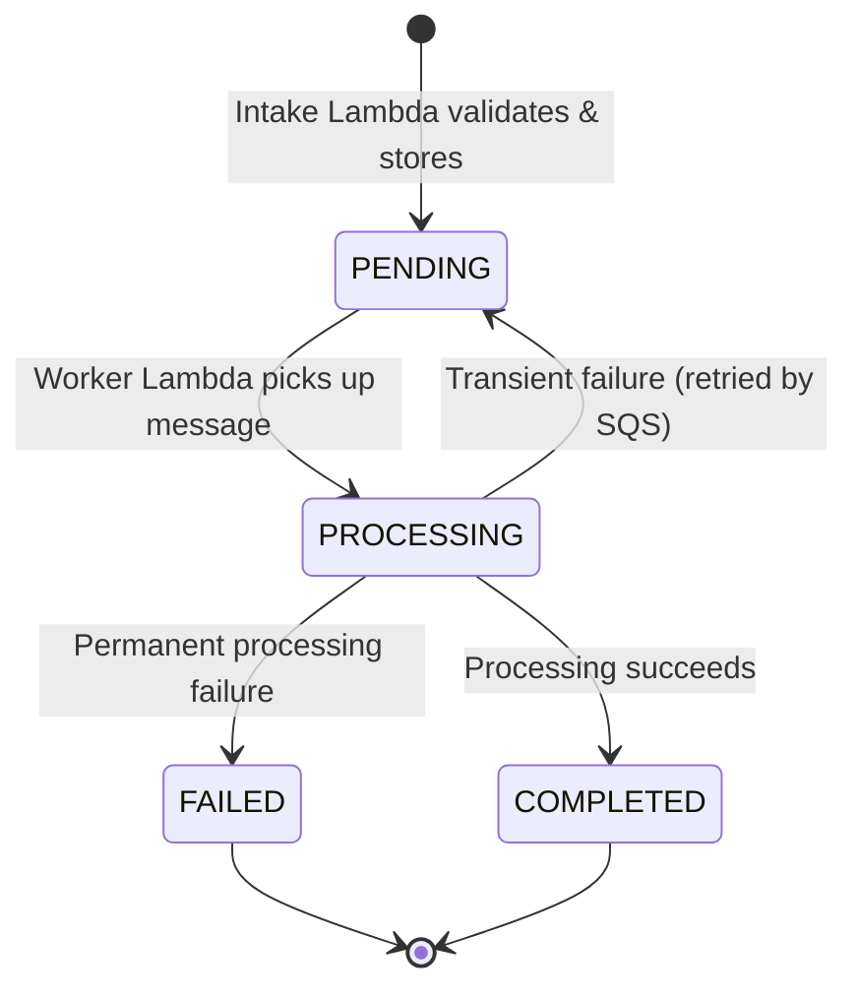

# Architecture Specification: Event-Driven Order Processing System

## 1. System Overview

The **Event-Driven Order Processing System** is a serverless, decoupled, asynchronous architecture designed on AWS. It decouples the client-facing HTTP intake interface from the downstream order processing and fulfillment logic using an asynchronous message queue.

### Target Architecture Diagram

```mermaid
flowchart TD
    Client["Client / HTTP Request"] -->|POST /orders| APIGW["Amazon API Gateway"]
    APIGW -->|Proxy Event| IntakeLambda["Lambda: order-processing-intake"]
    
    subgraph Storage & Queueing
        IntakeLambda -->|1. Store Initial Record| DDB[("Amazon DynamoDB: Orders Table")]
        IntakeLambda -->|2. Enqueue Message| SQS["Amazon SQS: orders-queue"]
        SQS -.->|Repeated Failures (maxReceiveCount)| DLQ["Amazon SQS: orders-dlq"]
    end
    
    subgraph Asynchronous Processing
        SQS -->|Event Source Mapping| WorkerLambda["Lambda: order-processing-worker"]
        WorkerLambda -->|3. Update Status to COMPLETED/FAILED| DDB
    end
    
    subgraph Observability
        IntakeLambda -.->|Logs & Diagnostics| CW["Amazon CloudWatch Logs"]
        WorkerLambda -.->|Logs & Diagnostics| CW
    end
```

---

## 2. Component Responsibilities

| Component | AWS Service | Primary Responsibility | Failure Strategy |
| :--- | :--- | :--- | :--- |
| **API Gateway** | Amazon API Gateway (HTTP/REST) | Exposes public HTTPS endpoint `POST /orders`, validates HTTP headers, routes request to Intake Lambda. | Returns standard 5xx if Lambda cannot be reached. |
| **Intake Handler** | AWS Lambda (`order-processing-intake`) | 1. Parses and validates input payload against schema.<br>2. Verifies idempotency to reject duplicate orders.<br>3. Saves initial order (`status: PENDING`) to DynamoDB.<br>4. Sends order event message to SQS queue.<br>5. Returns immediate HTTP 201 Created or 400 Bad Request to client. | If DynamoDB or SQS write fails, returns HTTP 500 without leaving orphaned state. |
| **Orders Store** | Amazon DynamoDB | Serves as the system of record. Stores order details, customer ID, items, amounts, timestamps, and current order status. | Highly durable, multi-AZ by default. Managed capacity. |
| **Work Queue** | Amazon SQS (`orders-queue`) | Buffers order processing tasks durably, smoothing out traffic spikes and decoupling intake from worker execution. | Messages kept durably for up to 14 days. Visibility timeout controls worker lease. |
| **Dead-Letter Queue** | Amazon SQS (`orders-dlq`) | Holds poisoned or permanently failing messages after max receive attempts are exhausted. | Isolates broken messages for manual inspection without halting the queue. |
| **Worker Handler** | AWS Lambda (`order-processing-worker`) | 1. Consumes batches from SQS.<br>2. Simulates/executes business logic (inventory, payment verification).<br>3. Updates DynamoDB record to `COMPLETED` or `FAILED`.<br>4. Deletes processed message from SQS upon successful execution. | Automatically retries up to `maxReceiveCount` (e.g. 3) before message is routed to DLQ. |
| **Observability** | Amazon CloudWatch Logs | Collects structured execution logs, invocation metrics, errors, and traces. | Retention set to 7-14 days to eliminate storage charges. |

---

## 3. Order Lifecycle and Status Transitions

Orders progress through well-defined, unidirectional status transitions:



- **`PENDING`**: Order received, validated, saved to DynamoDB, and queued in SQS.
- **`PROCESSING`**: Message received by worker, execution in progress.
- **`COMPLETED`**: Business logic, inventory, or billing completed successfully.
- **`FAILED`**: Business logic failed permanently (e.g., card declined, out of stock) or message sent to DLQ.

---

## 4. Contract and Schema Definition

### 4.1 Client Request Payload (`POST /orders`)
```json
{
  "order_id": "ord-98234-a1b2",
  "customer_id": "cust-5501",
  "items": [
    {
      "item_id": "item-101",
      "quantity": 2,
      "price": 19.99
    }
  ],
  "total_amount": 39.98,
  "currency": "USD"
}
```

### 4.2 Validation Rules
1. `order_id`: String, required, format matching alphanumeric and hyphens (`^[a-zA-Z0-9_-]{8,64}$`).
2. `customer_id`: String, required, non-empty.
3. `items`: Non-empty list of items. Each item must contain `item_id`, positive integer `quantity`, and positive float `price`.
4. `total_amount`: Number, positive, matching sum of item line prices within rounding tolerance.
5. `currency`: 3-letter ISO code (e.g., `USD`, `INR`, `EUR`).

### 4.3 Standard Success Response (`201 Created`)
```json
{
  "status": "success",
  "message": "Order accepted for processing",
  "data": {
    "order_id": "ord-98234-a1b2",
    "order_status": "PENDING",
    "created_at": "2026-10-18T00:55:00.000000Z"
  }
}
```

### 4.4 Standard Error Response (`400 Bad Request`)
```json
{
  "status": "error",
  "message": "Validation failed",
  "errors": [
    "Field 'total_amount' does not match the sum of item prices."
  ]
}
```

---

## 5. Reliability, Idempotency & Failure Handling

### 5.1 Idempotency Strategy
Clients may retry requests due to network timeouts. To prevent duplicate orders:
- The `order_id` acts as the idempotency key and DynamoDB partition key (`PK`).
- During intake, a conditional write (`attribute_not_exists(order_id)`) ensures an order cannot be overwritten or processed twice.
- If duplicate submission is detected, intake returns `409 Conflict` (or existing record status if idempotent caching is enabled).

### 5.2 SQS Visibility Timeout & DLQ Mechanics
- **Visibility Timeout:** Configured to at least **6x the Worker Lambda timeout** (e.g., 30s Lambda timeout -> 180s SQS visibility timeout) to prevent another worker instance from reprocessing an ongoing job prematurely.
- **Redrive Policy:** `maxReceiveCount = 3`. If a worker throws unhandled exceptions 3 times, SQS moves the message to `orders-dlq`.

---

## 6. Least-Privilege IAM Plan (For Stage 3 Preparation)

Neither Lambda function will have administrator privileges or broad wildcard actions:

- **Intake Execution Role:**
  - `dynamodb:PutItem` on `arn:aws:dynamodb:ap-south-1:*:table/Orders`
  - `sqs:SendMessage` on `arn:aws:sqs:ap-south-1:*:orders-queue`
  - Basic CloudWatch logging (`logs:CreateLogGroup`, `logs:CreateLogStream`, `logs:PutLogEvents`)
- **Worker Execution Role:**
  - `sqs:ReceiveMessage`, `sqs:DeleteMessage`, `sqs:GetQueueAttributes` on `arn:aws:sqs:ap-south-1:*:orders-queue`
  - `dynamodb:UpdateItem`, `dynamodb:GetItem` on `arn:aws:dynamodb:ap-south-1:*:table/Orders`
  - Basic CloudWatch logging

---

## 7. Cost & Free-Tier Guardrails

- **AWS Region:** `ap-south-1`
- **Lambda:** 1M free requests/month and 400,000 GB-seconds compute.
- **DynamoDB:** 25 GB free storage + 25 RCU/WCU (or On-Demand free request tier).
- **SQS:** 1M requests free/month.
- **CloudWatch:** 5 GB log ingestion free. Log retention capped to 7 days to eliminate storage charges.
- **Zero Out-of-Pocket Cost:** Test volume will use less than 0.1% of these allowances.
