# Architecture Specification: Event-Driven Order Processing System

## 1. System Overview

The **Event-Driven Order Processing System** is an educational serverless application with local implementation and deployment templates for an asynchronous order workflow. The worker currently runs a deterministic local business simulation; payment, inventory, shipping, and fulfillment integrations are not implemented. The templates describe a possible AWS deployment, but no live deployment or AWS behavior is verified by this document.

### Target Architecture Diagram

```mermaid
flowchart TD
    Client["Client / HTTP Request"] -->|POST /orders| APIGW["API Gateway HTTP API"]
    APIGW -->|Proxy Event| IntakeLambda["Lambda: order-processing-intake"]
    
    subgraph Storage & Queueing
        IntakeLambda -->|1. Store Initial Record| DDB[("Amazon DynamoDB: Orders Table")]
        IntakeLambda -->|2. Enqueue Message| SQS["Amazon SQS: orders-queue"]
        SQS -.->|Repeated Failures (maxReceiveCount)| DLQ["Amazon SQS: orders-dlq"]
    end
    
    subgraph Asynchronous Processing
        SQS -->|Event Source Mapping| WorkerLambda["Lambda: order-processing-worker"]
        WorkerLambda -->|3. Update Status to COMPLETED/FAILED| DDB
    end
    
    subgraph Observability
        IntakeLambda -.->|Logs & Diagnostics| CW["Amazon CloudWatch Logs"]
        WorkerLambda -.->|Logs & Diagnostics| CW
    end
```

---

## 2. Component Responsibilities

| Component | AWS Service | Primary Responsibility | Failure Strategy |
| :--- | :--- | :--- | :--- |
| **API Gateway** | API Gateway HTTP API | Template defines `POST /orders` with AWS IAM authorization and invokes the intake handler. | IAM authorization and deployed route behavior have not been verified in AWS. |
| **Intake Handler** | Lambda (`order-processing-intake`) | Parses and validates requests, creates or reuses an idempotent order record, publishes an SQS message, and records enqueue state. | A different payload for an existing order ID returns 409. An unresolved enqueue returns 503 and leaves the order available for same-payload retry; other unexpected errors return 500. |
| **Orders Store** | DynamoDB | Repository stores normalized order data, payload hash, order/enqueue state, generation, timestamps, attempts, and worker lease fields. | Template defines one on-demand table with a configurable name and Retain policies; live table state is unverified. |
| **Work Queue** | Standard SQS queue (`orders-queue`) | Carries order ID, payload hash, recovery generation, and message version for the worker. | Template values: 4-day retention and 60-second visibility timeout. The worker lease is separate: default 20 seconds (configurable 11-60 seconds). |
| **Dead-Letter Queue** | SQS DLQ (`orders-dlq`) | Template redrive policy uses `maxReceiveCount: 5`; the DLQ is available for investigation. | Template retention is 14 days. No deployed recovery API or recovery Lambda is defined. |
| **Worker Handler** | Lambda (`order-processing-worker`) | Consumes batch size one, checks hash/generation/status and a conditional lease, runs the local simulation, then records completion or permanent failure. | Template timeout is 10 seconds. Transient failures leave the lease to expire and the message retryable; template queue settings are not live-verified. |
| **Observability** | CloudWatch Logs | Source emits application log messages; templates define intake and worker log groups. | Template retention is 7 days. No custom alarms or tracing resources are defined. Retention does not eliminate all possible charges. |

---

## 3. Order Lifecycle and Status Transitions

Orders progress through well-defined, unidirectional status transitions:

```mermaid
stateDiagram-v2
    [*] --> PENDING: Intake Lambda validates & stores
    PENDING --> PROCESSING: Worker Lambda picks up message
    PROCESSING --> COMPLETED: Processing succeeds
    PROCESSING --> FAILED: Permanent processing failure
    PROCESSING --> PROCESSING: Transient failure; lease expires before retry
    PENDING --> RETRY_EXHAUSTED: Local recovery helper after triage
    PROCESSING --> RETRY_EXHAUSTED: Local recovery helper after expired lease and triage
    FAILED --> [*]
    COMPLETED --> [*]
```



- **`PENDING`**: Order is stored. Check `enqueue_state`: `NEEDS_ENQUEUE` means enqueue is unresolved; `ENQUEUED` means the enqueue marker was recorded.
- **`PROCESSING`**: Message received by worker, execution in progress.
- **`COMPLETED`**: The local simulation completed successfully; it does not represent payment, inventory, billing, or fulfillment.
- **`FAILED`**: A permanent validation/business-data failure was recorded. DLQ routing alone does not change the order status.
- **`RETRY_EXHAUSTED`**: A local recovery helper can record retry exhaustion after triage. This is not an automatic transition caused by SQS redrive.

The local DLQ recovery helper is not deployed. Redrive and manual DynamoDB edits are not authorized by the current pilot documentation; investigate messages before any separately approved recovery procedure.

---

## 4. Contract and Schema Definition

### 4.1 Client Request Payload (`POST /orders`)
```json
{
  "order_id": "ord-98234-a1b2",
  "customer_id": "cust-5501",
  "items": [
    {
      "item_id": "item-101",
      "quantity": 2,
      "price": 19.99
    }
  ],
  "total_amount": 39.98,
  "currency": "USD"
}
```

### 4.2 Validation Rules
1. `order_id`: String, required, format matching alphanumeric and hyphens (`^[a-zA-Z0-9_-]{8,64}$`).
2. `customer_id`: String, required, non-empty.
3. `items`: Non-empty list of items. Each item must contain `item_id`, positive integer `quantity`, and positive finite DynamoDB-compatible numeric `price`.
4. `total_amount`: Positive finite DynamoDB-compatible number, matching the sum of item line prices within the existing one-cent tolerance.
5. `currency`: 3-letter ISO code (e.g., `USD`, `INR`, `EUR`).

### 4.3 Standard Success Response (`201 Created`)
```json
{
  "status": "success",
  "message": "Order accepted for processing",
  "data": {
    "order_id": "ord-98234-a1b2",
    "order_status": "PENDING",
    "created_at": 1792284900,
    "enqueue_state": "ENQUEUED"
  }
}
```

### 4.4 Standard Error Response (`400 Bad Request`)
```json
{
  "status": "error",
  "message": "Validation failed",
  "errors": ["..."]
}
```

---

## 5. Reliability, Idempotency & Failure Handling

### 5.1 Idempotency Strategy
Clients may retry requests due to network timeouts. The `order_id` is the idempotency key. A matching payload hash reuses the existing order; a different payload for the same ID returns `409 Conflict`. Conditional DynamoDB writes protect state transitions. Publication is at-least-once: an accepted SQS send whose response is lost can be published again after a client retry. Worker state, payload hash, generation, and conditional lease checks make duplicate deliveries safe for this local simulation; they do not provide exactly-once SQS publication or delivery. `NEEDS_ENQUEUE` recovery depends on a same-payload client retry; there is no sweeper.

### 5.2 SQS Visibility Timeout & DLQ Mechanics
Template values are source queue visibility timeout 60 seconds, worker timeout 10 seconds, batch size 1, `maxReceiveCount = 5`, source retention 4 days, and DLQ retention 14 days. The worker lease is separate from queue visibility (default 20 seconds, configurable 11-60 seconds). These are template values, not verified deployed settings. SQS delivery is at-least-once.

---

## 6. IAM Configuration in Templates

Both templates define function execution roles with resource-scoped data-plane policies for the table and source queue, plus log-stream permissions. The intake role publishes messages and writes order state; the worker role reads/deletes source-queue messages and reads/updates order state. This is static template evidence only; effective IAM permissions have not been checked in AWS. Resource ARNs use the stack's partition, region, account, and resource prefix rather than hard-coded account identifiers.

---

## 7. Cost Objective and Limits

The intended region is `ap-south-1`, but templates do not hard-code a region; deployment uses the selected stack region. Zero out-of-pocket cost is an objective, not a guarantee. Pricing, free-tier eligibility, existing resources, usage, and billing were not verified. Template log retention is seven days; retention does not eliminate all possible charges.

## Current implementation and evidence boundary

Application code and local fakes implement the intake, repository, worker, and local DLQ recovery helper. The worker business action is simulated. Local tests establish behavior of this code and fakes only; they do not establish AWS service behavior, deployed configuration, permissions, or cost. `dlq_recovery.py` is not a deployed recovery function/API. Operators should inspect DLQ messages and investigate before any redrive; automatic redrive and manual DynamoDB edits are not authorized.
